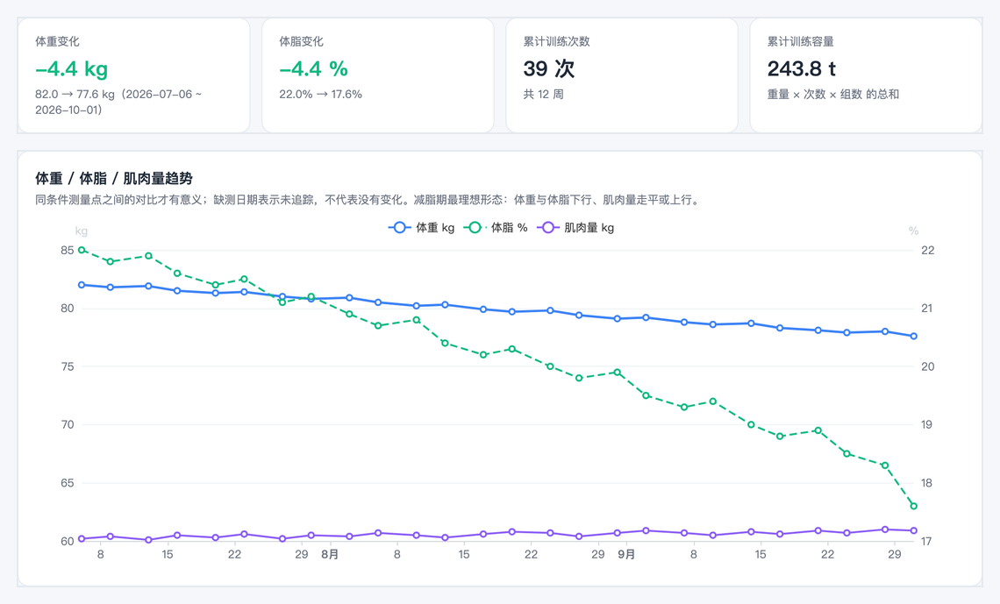
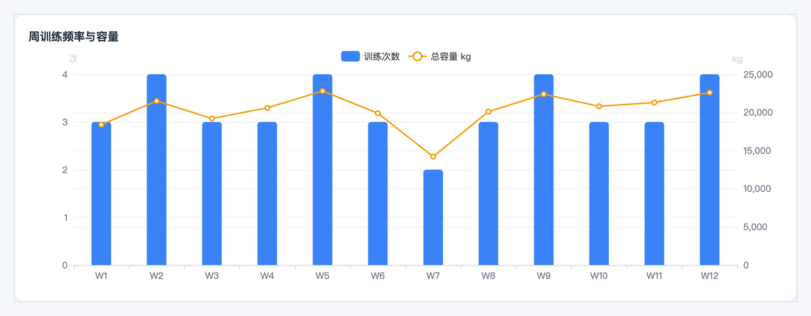
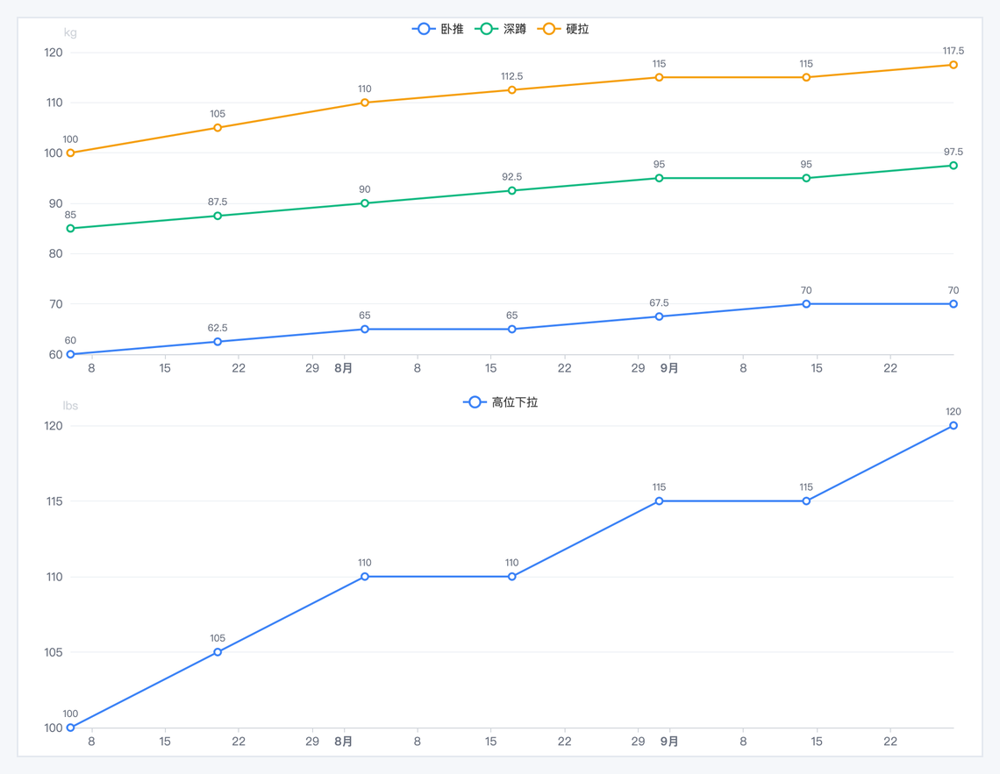
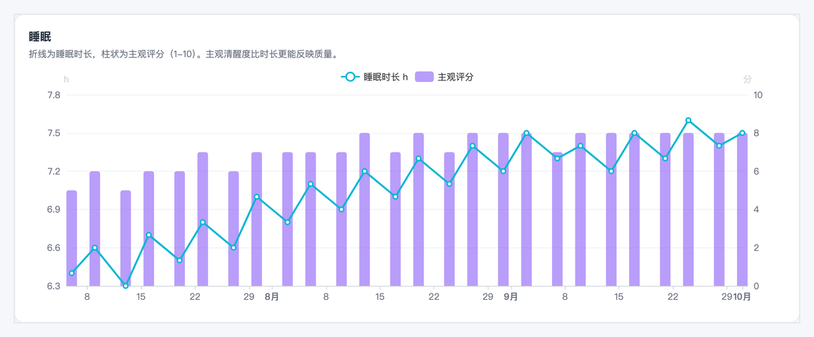
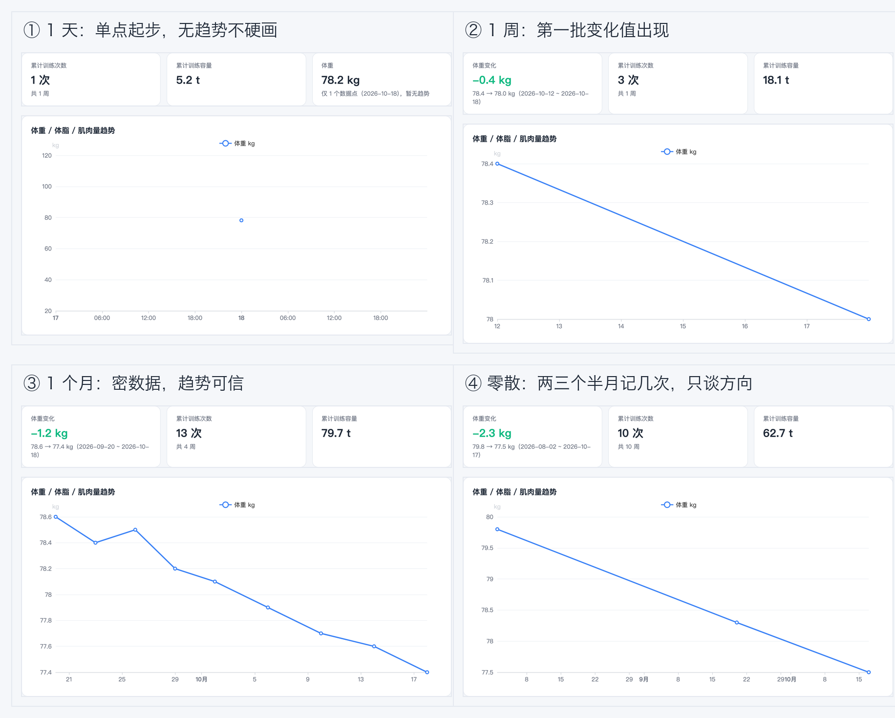
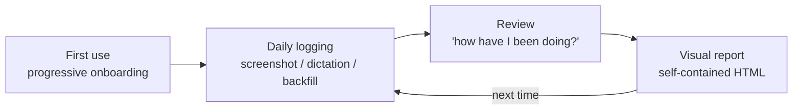

# fitlore

> Your training, remembered.

**English** | [简体中文](README.md)

  

An AI-agent skill that tracks your workouts and body metrics — built **low-frequency-native** for people who *don't* log every day.



## Why fitlore

Most fitness trackers quietly assume you'll log every day. You won't. You'll record for two weeks, disappear for three, and come back with a pile of gym-app screenshots.

fitlore doesn't fight that. It's designed around it:

- **Time-independent** — everything compares "this time vs last time", not "this week vs last week". Come back after a month and nothing is broken; a gap is just "not recorded", never a guilt trip.
- **Batch backfill is a first-class citizen** — dump five screenshots and a few voice notes from the past three weeks in one go. fitlore parses them, places them by date, and reviews the whole span as one conversation.
- **Density-adaptive analytics** — dense data gets trend analysis; sparse data gets honest direction-only statements. It never pretends four data points are a trend.
- **Minimal-data first** — weight + training data alone power the full experience. Body fat, muscle mass, sleep, alcohol, nutrition are all optional; missing sections simply hide in charts.

## What you say → what it does

| You say | The agent does |
|:--|:--|
| "Help me set up" / 「帮我建档」 | A progressive interview (only 3 required questions) → your profile + a `fitness-data/` directory |
| Send a gym-app screenshot | Parses exercises, sets × reps × weight, volume → appends to CSVs → reports back |
| "Log these past few days" + 5 screenshots | Batch backfill: parses everything, places by date, merges into one review |
| Drop in a CSV exported from any gym app | Validates units & comparability → converts to the skill's CSVs → reports anomalies before writing |
| "How have I been doing?" / 「盘一下最近」 | Conversational review since your last one — pain grading, PR detection, one document |
| "How's my bench progressing?" / 「卧推进步了吗」 | Compares same-unit, same-mode history → answers with numbers computed by script, not guessed |
| "Show my progress" / 「看看我的数据」 | Generates a self-contained HTML dashboard — double-click to open, no server needed |

## Quickstart

```bash
git clone https://github.com/buuzzy/fitlore.git && mkdir -p ~/.workbuddy/skills && cp -r fitlore ~/.workbuddy/skills/
```

(For Claude Code, copy into `~/.claude/skills/` instead. For a single project, use `<project>/.claude/skills/`.)

Then just say **"help me set up"** (or 「帮我建档」). A few minutes later you have a profile, and your first logged workout can follow immediately.

## A complete 12-week example

The images below come from a built-in fictional example (data included in `examples/`) that exercises every visualization the skill can render — body composition, training cadence, exercise progress and sleep, all at once:





- **Weight −4.4kg, body fat −4.4pp, muscle +0.7kg** — the textbook shape of a successful cut: both down-lines while muscle holds
- **39 sessions across 12 weeks** with one planned deload week (W7) shown honestly as a dip, not hidden
- **Every exercise line trending up** — progression as an outcome, not a target



- **Sleep duration and subjective score trending up** alongside training — rendered when the user tracks them, hidden when they don't

## Built for however much (or little) you log

The same report adapts to your data density — no errors, no empty charts, no guilt:



| You have | What the report shows |
|:--|:--|
| **1 day** | Single-point KPIs marked "no trend yet"; charts render honest isolated dots |
| **1 week** | First deltas appear; point-to-point direction only — never a rate from two points |
| **1 month** | Dense-data mode: means comparison, credible trend lines, rates allowed |
| **Scattered (2–3 records in 10 weeks)** | Direction-only statements, gaps rendered as blanks, large-span KPIs still meaningful |

Open `examples/scenarios/index.html` after cloning to switch between all four live.

## How it works



**The skill is the method, your files are the database.** fitlore contains zero personal data — it's all workflow, methodology and chart templates. Your data lives in a `fitness-data/` directory created at runtime:

| File | One row per | Columns |
|:--|:--|:--|
| `measurements.csv` | measurement day | `date, weight_kg, bodyfat_pct, muscle_kg, sleep_h, sleep_score, alcohol_std, notes` |
| `sessions.csv` | workout session | `date, type, duration_min, total_volume_kg, calories, notes` |
| `exercises.csv` | exercise | `date, exercise, sets, reps, weight, unit, side, notes` |

All three are **append-only**: history can't be silently rewritten, and corrections go through an auditable "annotate, don't overwrite" rule. Missing values stay empty — `0` and "not tracked" are different things.

Dashboards are built with one command:

```bash
python3 assets/build_dashboard.py --data your-data.json --out dashboards/2026-10.html
```

The script injects your data and the ECharts library into a template, producing a single self-contained HTML (~1MB) that opens anywhere — no server, no network, nothing to install for the viewer.

## What makes it different

- **Unit & mode comparability rules** — the #1 source of wrong training insights is comparing kg against lbs, or unilateral against bilateral records. fitlore validates comparability before *any* comparison, PR detection included.
- **"Not recorded ≠ not measured"** — before declaring any dimension "long empty", the skill must ask you once. People usually have the data; they just don't hand it over.
- **No-progress-shaming by default** — unless you explicitly pick strength as your goal, "didn't add weight" is never framed as a failure. Holding weight while cutting is a win; a flat line can be the best line in the chart.
- **Pain grading baked in** — soreness / tightness / sharp pain / numbness each get a different protocol, checked in every review. Safety red lines outrank every training suggestion.
- **A log operator, not a coach** — fitlore shows you what happened and what changed; it doesn't prescribe programs. It helps you *see*, never decides *for* you.

## FAQ

**Do I have to log every day?**
No. The skill assumes you won't. Record whenever you remember, backfill weeks at once, and gaps render as blanks.

**Where does my data go?**
Nowhere. Everything stays in a local `fitness-data/` directory. The repo itself contains zero personal data — a hard design rule, verified before every release.

**My gym app isn't Hevy/Strong — can I still import data?**
Yes. Parsing file formats is the agent's native ability; the skill only enforces the data contract: confirm units first, convert by script, report anomalies before writing.

**Does it write training programs for me?**
No. fitlore is a training-log operator, not a personal trainer — it tracks, reviews and visualizes; it doesn't prescribe.

## Repository map

```
fitlore/
├── SKILL.md                      # entry point: triggers, state machine, core principles
├── references/                   # onboarding · data collection · review workflow · analysis rules · visualization
├── assets/
│   ├── dashboard-template.html   # ECharts report template
│   ├── build_dashboard.py        # one-command dashboard builder
│   └── echarts.min.js            # Apache ECharts 5 (Apache-2.0)
├── examples/
│   ├── data-demo.json            # fictional demo user
│   ├── dashboard-demo.html       # generated demo report — double-click to preview
│   └── scenarios/                # four-density demo: 1 day / 1 week / 1 month / sparse
│                                 #   → open scenarios/index.html to switch between them
├── assets/images/             # images used in this README
├── CHANGELOG.md
└── LICENSE
```

## Requirements

- Any AI-agent environment with file access (WorkBuddy, Claude Code, …) and Python 3.8+ (standard library only)
- Charts are powered by [Apache ECharts](https://echarts.apache.org/), pre-embedded into every generated report — the person *viewing* a report installs nothing

## License

MIT — see [LICENSE](LICENSE).
