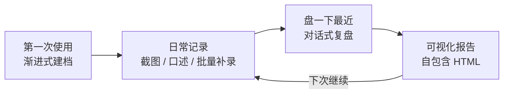

# fitlore

> 你的训练，值得被记住。

**简体中文** | [English](README.en.md)

  

一套 AI Agent 健身追踪技能，**低频原生**设计——为那些不会每天打卡的真实用户而做。


## 为什么是 fitlore

大多数健身追踪工具默认你会天天记录。但你不会：认真记两周，消失三周，然后带着一堆训练 APP 截图回来。

fitlore 不跟这种懒惰搏斗，而是围绕它设计：

- **时间无关**：一切分析用「本次 vs 上一次」，不按日历周期。一个月没来，什么都不会坏——空白期就写「未记录」，绝不追责。
- **批量补录是一等公民**：三周的截图和口述一次全交上来，技能批量解析、按日期归位、合并成一次复盘。
- **趋势方法随数据密度自适应**：数据密就做趋势分析；数据稀就诚实地说「只谈方向」。绝不把四个数据点假装成趋势。
- **极简数据优先**：只有体重 + 训练数据就能用全全部功能。体脂、肌肉量、睡眠、酒精、饮食全可选，缺的板块在图表里自动隐藏。

## 你说什么 → 它做什么

| 你说 | AI 做什么 |
|:--|:--|
| 「帮我建档」 | 渐进式问卷（强问项只有 3 个）→ 个人档案 + 初始化 `fitness-data/` 目录 |
| 发一张训练 APP 截图 | 解析动作、组数 × 次数 × 重量、容量 → 追加进 CSV → 回报记录结果 |
| 「补录这几天」+ 5 张截图 | 批量补录：全部解析、按日期归位、合并出一份复盘 |
| 丢来一个任意训练 APP 导出的表格 | 校验单位与口径 → 转换成技能的三张 CSV → 落盘前先回报异常行 |
| 「盘一下最近」 | 自上次复盘以来的对话式复盘——疼痛分级、PR 检测、产出一份文档 |
| 「卧推进步了吗」 | 只比同单位、同口径的历史 → 数字由脚本计算，不是模型心算 |
| 「看看我的数据」 | 生成自包含 HTML 可视化报告——双击即开，无需服务器 |

## 快速开始

```bash
npx degit buuzzy/fitlore fitlore
```

然后把 `fitlore` 文件夹放入你的 Agent 的技能目录（目录位置以你所用 Agent 的文档为准，用户级或项目级均可），重启会话即可生效。备选方式：`git clone https://github.com/buuzzy/fitlore.git`。

装好后直接说「帮我建档」。几分钟后你就有了一份个人档案，可以立刻记录第一次训练。

## 完整 12 周示例

下面两张图来自内置的虚构示例用户（数据在 `examples/` 里，随仓库分发），一次性点亮技能的全部可视化能力——身体成分、训练节奏、动作进步、睡眠：


- **体重 −4.4kg、体脂 −4.4pp、肌肉量 +0.7kg**——减脂成功的教科书形态：两条线下行，肌肉守住
- **12 周 39 次训练**，第 7 周计划性减载如实显示为回落，不隐藏
- **所有动作线全部向上**——进步是结果，不是目标


- **睡眠时长与主观分随训练同步改善**——用户追踪就展示，不追踪就隐藏

## 记多少，都能看

同一套报告，随你的数据密度自适应——不报错、不出空图、不制造愧疚：


| 你手里有什么 | 报告展示什么 |
|:--|:--|
| **1 天** | 指标卡标「暂无趋势」，图表诚实显示孤立点 |
| **1 周** | 第一批变化值出现；只谈点对点方向，绝不用两个点算速率 |
| **1 个月** | 密数据模式：均值对比、趋势线可信、允许出现速率结论 |
| **零散（10 周记 2-3 次）** | 只谈方向、空白如实显示，大跨度 KPI 依然有信息量 |

clone 之后打开 `examples/scenarios/index.html`，四个场景可实时切换查看。

## 工作原理



**技能是方法，你的文件是数据库。** fitlore 本身零个人数据——只有流程、方法论和图表模板。你的数据存放在运行时创建的 `fitness-data/` 目录：

| 文件 | 每行代表 | 列 |
|:--|:--|:--|
| `measurements.csv` | 一次身体测量 | `date, weight_kg, bodyfat_pct, muscle_kg, sleep_h, sleep_score, alcohol_std, notes` |
| `sessions.csv` | 一次训练 | `date, type, duration_min, total_volume_kg, calories, notes` |
| `exercises.csv` | 一个动作 | `date, exercise, sets, reps, weight, unit, side, notes` |

三张表**只追加**：历史记录不可能被静默改写，纠错必须走「留痕不覆盖」的可审计规则。缺失值保持留空——`0` 和「未追踪」是两回事。

可视化报告一条命令生成：

```bash
python3 assets/build_dashboard.py --data 你的数据.json --out dashboards/2026-10.html
```

脚本把你的数据和 ECharts 图表库注入模板，产出一个约 1MB 的单文件 HTML——不需要服务器、不需要联网，看报告的人什么都不用装。

## 与同类项目的区别

- **单位与口径可比性规则**：训练分析错误的第一大来源是拿 kg 对比 lbs、拿单侧对比双侧。fitlore 在任何对比（包括 PR 检测）之前先做口径校验。
- **「没记录 ≠ 没测」**：判定任何维度「长期空白」之前，技能必须先问你一次。用户通常手里有数据，只是没主动交。
- **默认不羞辱进步**：除非你明确选择力量为目标，「没加重」永远不会被写成失败。减脂期守住重量就是赢——平线可以是图上最好的一条线。
- **疼痛分级内建**：酸胀 / 发紧 / 刺痛 / 发麻各有对应处置，每次复盘必核。安全红线的优先级高于一切训练建议。
- **是日志运营者，不是教练**：fitlore 告诉你发生了什么、变化了什么；它不排课、不替你决定。它帮你「看清」，从不替你「拍板」。

## 常见问题

**必须每天记录吗？**
不用。技能就是按「你不记」设计的：想起来就记、一次补几周、空白如实显示。

**我的数据会被传到哪里？**
哪里都不去。全部留在本地 `fitness-data/` 目录。仓库本身零个人数据——这是硬性设计规则，每次发布前都会扫描验证。

**我的训练 APP 不是 Hevy / Strong，还能导入吗？**
可以。解析具体文件格式是 Agent 的原生能力；技能只负责数据契约：先确认单位、脚本转换、落盘前回报异常。

**它会帮我排训练计划吗？**
不会。fitlore 是训练日志的运营者，不是私教——它负责追踪、复盘、可视化，不负责开处方。

## 仓库结构

```
fitlore/
├── SKILL.md                      # 主入口：触发词、状态机、核心原则
├── references/                   # 建档 · 数据收集 · 复盘工作流 · 判断规则 · 可视化
├── assets/
│   ├── dashboard-template.html   # ECharts 报告模板
│   ├── build_dashboard.py        # 一键构建脚本
│   └── echarts.min.js            # Apache ECharts 5（Apache-2.0）
├── examples/
│   ├── data-demo.json            # 虚构示例用户
│   ├── dashboard-demo.html       # 示例报告成品——双击预览
│   └── scenarios/                # 四种数据密度演示：1 天 / 1 周 / 1 个月 / 零散
│                                 #   → 打开 scenarios/index.html 可切换查看
├── assets/images/             # README 配图
├── CHANGELOG.md
└── LICENSE
```

## 环境要求

- 任意具备文件读写能力的 AI Agent 环境 + Python 3.8+（仅标准库）
- 图表基于 [Apache ECharts](https://echarts.apache.org/)，已预嵌入每份生成的报告——看报告的人什么都不用装

## 许可证

MIT — 见 [LICENSE](LICENSE)。
