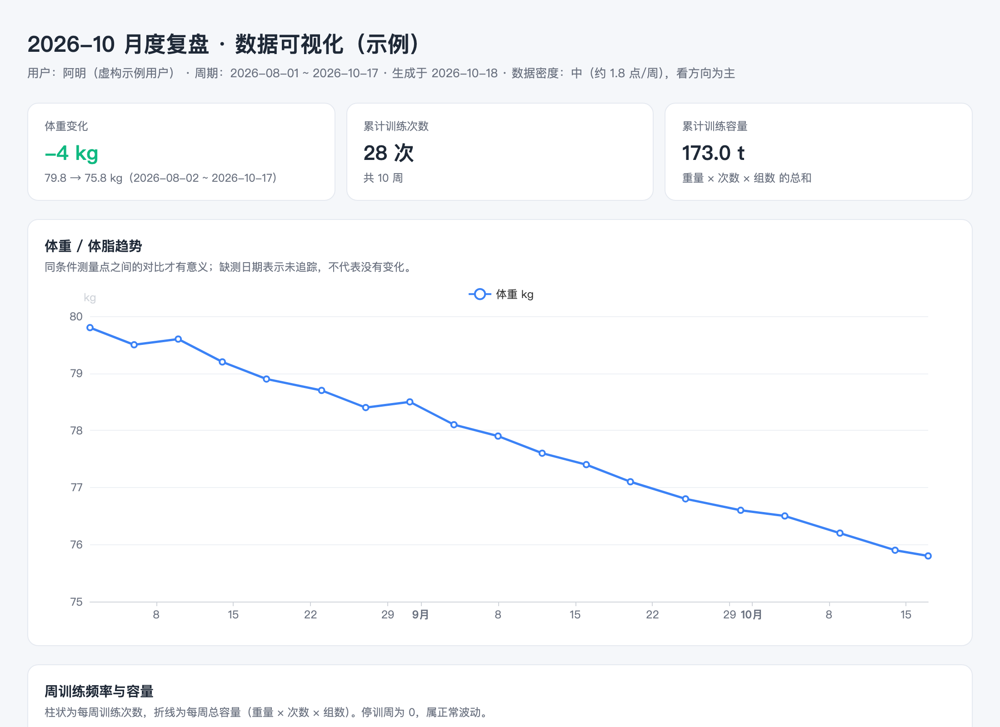

# fitlore

> 你的训练，值得被记住。

[English](README.md) | **简体中文**

  

一套 AI Agent 健身追踪技能，**低频原生**设计——为那些不会每天打卡的真实用户而做。



## 为什么是 fitlore

大多数健身追踪工具默认你会天天记录。但你不会：认真记两周，消失三周，然后带着一堆训练 APP 截图回来。

fitlore 不跟这种懒惰搏斗，而是围绕它设计：

- **时间无关**：一切分析用「本次 vs 上一次」，不按日历周期。一个月没来，什么都不会坏——空白期就写「未记录」，绝不追责。
- **批量补录是一等公民**：三周的截图和口述一次全交上来，技能批量解析、按日期归位、合并成一次复盘。
- **趋势方法随数据密度自适应**：数据密就做趋势分析；数据稀就诚实地说「只谈方向」。绝不把四个数据点假装成趋势。
- **极简数据优先**：只有体重 + 训练数据就能用全全部功能。体脂、睡眠、酒精、饮食全可选，缺的板块在图表里自动隐藏。

## 你说什么 → 它做什么

| 你说 | AI 做什么 |
|:--|:--|
| 「帮我建档」 | 渐进式问卷（强问项只有 3 个）→ 个人档案 + 初始化 `fitness-data/` 目录 |
| 发一张训练 APP 截图 | 解析动作、组数 × 次数 × 重量、容量 → 追加进 CSV → 回报记录结果 |
| 「补录这几天的训练」 | 批量补录：全部解析、按日期归位、合并出一份复盘 |
| 「盘一下最近」 | 自上次复盘以来的对话式复盘——疼痛分级、PR 检测、产出一份文档 |
| 「看看我的数据」 | 生成自包含 HTML 可视化报告——双击即开，无需服务器 |

## 快速开始

```bash
git clone https://github.com/buuzzy/fitlore.git && mkdir -p ~/.workbuddy/skills && cp -r fitlore ~/.workbuddy/skills/
```

（Claude Code 用户把拷贝目标换成 `~/.claude/skills/`；单个项目使用则放 `<项目>/.claude/skills/`。）

装好后直接说「帮我建档」。几分钟后你就有了一份个人档案，可以立刻记录第一次训练。

## 工作原理

**技能是方法，你的文件是数据库。** fitlore 本身零个人数据——只有流程、方法论和图表模板。你的数据存放在运行时创建的 `fitness-data/` 目录：

```
fitness-data/
├── profile.md          # 个人档案（建档产出）
├── measurements.csv    # 体重、体脂、睡眠——只追加
├── sessions.csv        # 每次训练一行——只追加
├── exercises.csv       # 每个动作一行——只追加
├── reviews/            # 复盘文档
└── dashboards/         # 生成的自包含 HTML 报告
```

CSV 采用只追加设计：历史记录不可能被静默改写，纠错必须走「留痕不覆盖」的可审计规则。

可视化报告一条命令生成——`assets/build_dashboard.py` 把你的数据和 ECharts 图表库注入模板，产出一个约 1MB 的单文件 HTML，在任何设备上双击即开。

## 与同类项目的区别

- **单位与口径可比性规则**：训练分析错误的第一大来源是拿 kg 对比 lbs、拿单侧对比双侧。fitlore 在任何对比（包括 PR 检测）之前先做口径校验。
- **「没记录 ≠ 没测」**：判定任何维度「长期空白」之前，技能必须先问你一次。用户通常手里有数据，只是没主动交。
- **默认不羞辱进步**：除非你明确选择力量为目标，「没加重」永远不会被写成失败。减脂期守住重量就是赢。
- **疼痛分级内建**：酸胀 / 发紧 / 刺痛 / 发麻各有对应处置，每次复盘必核。安全红线的优先级高于一切训练建议。

## 数据与隐私

- 技能本身**不含任何个人数据**——只有流程、规则和模板，天然可以放心开源。
- 你的全部数据留在本地 `fitness-data/` 目录，不经过任何第三方。
- 环境要求：任意具备文件读写能力的 AI Agent 环境 + Python 3.8+（仅标准库）。图表基于 [Apache ECharts](https://echarts.apache.org/)，已预嵌入每份生成的报告——使用者无需安装任何东西。

## 仓库结构

```
fitlore/
├── SKILL.md                      # 主入口：触发词、状态机、核心原则
├── references/                   # 建档 · 数据收集 · 复盘工作流 · 判断规则 · 可视化
├── assets/
│   ├── dashboard-template.html   # ECharts 报告模板
│   ├── build_dashboard.py        # 一键构建脚本
│   └── echarts.min.js            # Apache ECharts 5（Apache-2.0）
├── examples/
│   ├── data-demo.json            # 虚构示例用户
│   ├── dashboard-demo.html       # 示例报告成品——双击预览
│   └── scenarios/                # 四种数据密度演示：1 天 / 1 周 / 1 个月 / 零散
│                                 #   → 打开 scenarios/index.html 可切换查看
├── docs/screenshots/             # README 配图
├── CHANGELOG.md
└── LICENSE
```

## 许可证

MIT — 见 [LICENSE](LICENSE)。
